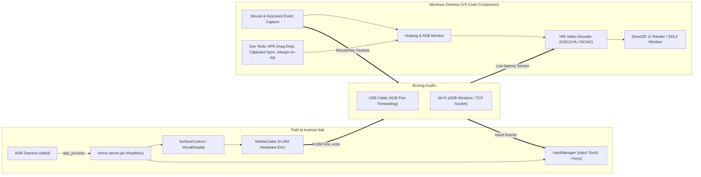

# Appcuatao — Kế Hoạch Nâng Cấp Tối Ưu Cho Developer (VS Code + Thiết Bị Thật)

## Goal Description

Người dùng hiện đang chuyển từ Android Studio sang VS Code kết hợp cắm thiết bị thật để lập trình nhằm tránh sự cồng kềnh, nặng nề của Android Studio. Tuy nhiên, việc liên tục phải cúi xuống nhìn và thao tác trên điện thoại vật lý làm gián đoạn mạch làm việc.

**Mục tiêu của dự án Appcuatao:**
Xây dựng công cụ phản chiếu (mirror) màn hình điện thoại Android lên máy tính Windows với tiêu chí:

1. **Siêu nhẹ & Hiệu năng cao:** Latency < 30ms, 60 FPS mượt mà, tiêu tốn cực ít RAM (< 40–50MB) và CPU (< 2–3%), khởi động tức thì (< 0.5s).
2. **Thao tác 1:1 như máy ảo:** Nhấn, vuốt, chạm đa điểm (zoom/pinch), gõ phím trực tiếp (kể cả tiếng Việt), phím tắt điều hướng (Back, Home, App Switcher, Power, Volume).
3. **Cá nhân hóa & 100% Miễn phí:** Hoàn toàn chạy offline, không quảng cáo, không cloud, mã nguồn mở, tinh chỉnh riêng cho workflow VS Code.
4. **Cực kỳ dễ dùng (Zero-Install trên điện thoại):** Cắm cáp USB là màn hình tự lên; không cần cài đặt APK thủ công trên điện thoại mỗi lần build, không hiện popup hỏi quyền phiền toái.

---

## Đánh Giá Kế Hoạch Cũ (`native-mirror-plan.md`) & Các Điểm Cần Lột Xác

Bản kế hoạch ban đầu (`native-mirror-plan.md`) đã có nền tảng tốt về tư duy xử lý video pipeline (MediaCodec H.264 + D3D11). Tuy nhiên, có **4 điểm nghẽn nghiêm trọng** cản trở mục tiêu thực tế của người dùng:

| Hạng mục                | Kế hoạch cũ (`native-mirror-plan.md`)                       | Điểm nghẽn thực tế                                                                                                                                                                                      | Giải pháp nâng cấp ở Bản 2.0                                                                                                                                                      |
| ----------------------- | ----------------------------------------------------------- | ------------------------------------------------------------------------------------------------------------------------------------------------------------------------------------------------------- | --------------------------------------------------------------------------------------------------------------------------------------------------------------------------------- |
| **Cơ chế Android**      | Cài APK (Kotlin + Jetpack Compose) + `MediaProjection`      | ❌ **Không thể điều khiển điện thoại:** App thường bị Android chặn quyền inject touch/key sang app khác. ❌ Mỗi lần chạy phải mở app trên đt, bấm popup cấp quyền MediaProjection rất mất thời gian. | ✅ **ADB Headless Server (`app_process`):** Chạy daemon với quyền `shell` (UID 2000). Không cần cài APK vào đt, bypass popup màn hình, toàn quyền inject touch, vuốt, gõ chữ 1:1. |
| **Giao diện Desktop**   | Flutter Desktop (Dart) + C++ Native Plugin + Texture Bridge | ❌ Flutter Engine tốn ~150–250MB RAM, file cài ~50–80MB. ❌ Cầu nối FFI/Texture bridge giữa D3D11 và Flutter tăng độ trễ 1–2 frame (16–33ms).                                                        | ✅ **Native C++20 + SDL2 / Direct3D 11:** Render trực tiếp GPU swapchain. RAM chỉ ~35–45MB, khởi động tức thì, dung lượng gọn nhẹ (< 15MB).                                       |
| **Kênh kết nối**        | Ưu tiên Wi-Fi LAN trước, USB sau                            | ❌ Developer cắm cáp USB để debug VS Code mỗi ngày; Wi-Fi có thể jitter, ping cao, tốn pin.                                                                                                             | ✅ **Ưu tiên USB qua ADB tunnel:** Ping < 1ms, băng thông ổn định tuyệt đối, vừa sạc pin vừa mirror. Vẫn giữ tùy chọn ADB Wi-Fi tiện lợi.                                         |
| **Tính năng Developer** | Chưa có tính năng hỗ trợ workflow                           | ❌ Thiếu các tiện ích cần thiết khi code.                                                                                                                                                               | ✅ Bổ sung: Ghim cửa sổ (Always-on-Top), kéo thả file `.apk` để tự cài đặt, đồng bộ Clipboard 2 chiều, tắt màn hình vật lý khi đang mirror để chống nóng máy.                     |

---

## Kiến Trúc Hệ Thống NativeMirror 2.0

---

## User Review Required

> [!IMPORTANT]
> **Quyết định cốt lõi về Android Agent (Zero-Install qua ADB thay vì cài APK):**
> Để đạt được tính năng **nhấn, chạm, điền chữ toàn hệ thống** mượt như máy ảo Android Studio, bắt buộc phải dùng tiến trình chạy dưới quyền `shell` qua ADB (`app_process`). Phương án này giúp:
>
> - Người dùng **không cần cài bất kỳ ứng dụng nào** lên điện thoại.
> - Cắm cáp USB là máy tính tự đẩy file `mirror-server.jar` (~60KB) vào bộ nhớ đệm và kích hoạt chạy ngầm.
> - Điện thoại không có rác, không tốn dung lượng lưu trữ.

> [!NOTE]
> **Lựa chọn công nghệ UI Desktop:**
>
> - **Khuyến nghị (Phương án 1 — C++20 + SDL2 / DirectX 11):** Đây là phương án tối ưu nhất cho hiệu năng, đạt chuẩn mục tiêu "thay thế Android Studio nặng nề" (RAM ~35MB, CPU ~1-2%, khởi động 0.1s, binary ~15MB).
> - **Phương án 2 (Flutter Desktop + C++ Texture Bridge):** Nếu bạn muốn giao diện hiện đại với nhiều trang setting cầu kỳ bằng Flutter. Tuy nhiên, nó sẽ tốn ~180MB RAM và cần cơ chế chia sẻ D3D11 texture phức tạp hơn.

---

## Open Questions

1. **Lựa chọn UI Client:** Bạn muốn đi theo **Phương án 1 (C++20 + SDL2/DirectX 11 siêu nhẹ, tối giản)** hay vẫn muốn giữ **Phương án 2 (Flutter Desktop)** của plan cũ?
2. **Tùy chọn tắt màn hình điện thoại:** Khi cắm máy tính để code nhiều giờ, bạn có muốn tính năng tự động tắt màn hình điện thoại vật lý (nhưng máy tính vẫn hiển thị và điều khiển bình thường) để bảo vệ pin và chống chai/nóng máy không?
3. **Độ phân giải & Tỉ lệ khung hình mong muốn:** Thiết bị của bạn có màn hình 60Hz, 90Hz hay 120Hz? Mục tiêu mặc định sẽ là 1080p @ 60fps (hoặc giới hạn 8Mbps để đảm bảo độ trễ dưới 25ms).

---

## Chi Tiết Các Thay Đổi & Nâng Cấp Kỹ Thuật

### 1. Thành Phần Android: `mirror-server` (Headless Server)

- **Công nghệ:** Java / Kotlin thuần, build ra file `mirror-server.jar` / `.dex` siêu nhỏ (~60KB).
- **Quyền hạn:** Chạy qua `app_process` với UID 2000 (`shell`), sở hữu quyền `android.permission.INJECT_EVENTS`.
- **Cơ chế Capture:**
  - Sử dụng API ẩn `SurfaceControl.createDisplay` (Android 10 đến Android 15+) để chụp trực tiếp toàn bộ màn hình vào `Surface` của `MediaCodec`.
  - Không cần thông qua `MediaProjection` UI dialog, không làm gián đoạn người dùng.
- **Cơ chế Encode:**
  - `MediaCodec` cấu hình H.264 Baseline/High Profile, Low-Latency Mode (`KEY_LATENCY = 0`, `KEY_PRIORITY = 0`), intra-refresh rate nhanh để bắt kịp khung hình tức thì.
- **Cơ chế Input Injection:**
  - Nhận các gói tin touch/key từ PC qua socket.
  - Sử dụng `InputManager.getInstance().injectInputEvent()` để đẩy trực tiếp `MotionEvent` (chạm, nhả, di chuyển) và `KeyEvent` (nhấn phím, gõ text).

### 2. Thành Phần Windows: Native Core & Client UI

- **Khung cửa sổ & Render:**
  - Dùng **SDL2** kết hợp **Direct3D 11**: Quản lý cửa sổ, bắt sự kiện chuột/bàn phím, fullscreen, resize giữ nguyên tỉ lệ màn hình điện thoại.
  - Render trực tiếp decoded GPU texture vào D3D11 Swapchain, không qua bất kỳ lớp trung gian nào để đạt độ trễ 0-copy.
- **Hardware Video Decoder:**
  - Tích hợp **FFmpeg (`avcodec`)** với bộ giải mã phần cứng **D3D11VA** / **DXVA2** (hỗ trợ cả Intel HD Graphics, Nvidia GTX/RTX, AMD Radeon).
  - Tốc độ decode: < 4ms cho một khung hình 1080p 60fps.
- **Bắt và ánh xạ tương tác:**
  - **Chuột:**
    - Click chuột trái: Chạm (Touch Down / Up)
    - Giữ và rê chuột trái: Vuốt (Swipe / Scroll)
    - Click chuột phải: Nút **Back** (Trở lại)
    - Click con lăn chuột: Nút **Home** (Về màn hình chính)
    - Cuộn chuột: Cuộn danh sách mượt mà (Scroll Wheel)
  - **Bàn phím:**
    - Gõ phím ký tự: Tự động inject vào ô input đang focus trên điện thoại.
    - Hỗ trợ bộ gõ tiếng Việt (Unikey/EVKey) qua cơ chế đồng bộ text buffer hoặc IME input injection.
    - Phím tắt hệ thống:
      - `Ctrl + S`: Mở trình chuyển ứng dụng (Recent Apps)
      - `Ctrl + P`: Bật / Tắt nguồn màn hình (Power toggle)
      - `Ctrl + Up / Down`: Tăng / Giảm âm lượng
      - `Ctrl + Shift + R`: Xoay ngang / dọc màn hình (Rotation)

### 3. Tối Ưu Quy Trình Làm Việc Với VS Code (Developer Companion)

- **Auto-Hotplug Detection:**
  - Client liên tục lắng nghe sự kiện cắm/rút USB qua ADB. Khi cắm máy thật vào, cửa sổ mirror tự động xuất hiện; rút cáp ra thì tự động ẩn hoặc đóng kết nối nhẹ nhàng.
- **Always-on-Top:**
  - Phím tắt `Ctrl + T` để ghim cửa sổ mirror luôn nổi phía trên, đặt vừa vặn bên cạnh VS Code. Bạn vừa sửa code, vừa thấy màn hình cập nhật ngay lập tức.
- **Kéo thả cài đặt APK:**
  - Bạn chỉ cần kéo file `.apk` từ thư mục `build/outputs/apk/` của dự án và thả vào cửa sổ NativeMirror, phần mềm sẽ tự động chạy ngầm lệnh `adb install -r -d` và hiển thị thông báo.
- **Clipboard Sync:**
  - Copy một đoạn link, token hoặc chuỗi JSON trên VS Code (Windows) -> Nhấn Paste trên điện thoại sẽ nhận ngay lập tức, và ngược lại.

---

## So Sánh Hiệu Năng & Tài Nguyên

| Tiêu chí                                 | Android Studio Device Mirroring    | NativeMirror Cũ (Flutter) | **NativeMirror 2.0 (Đề xuất)**                               |
| ---------------------------------------- | ---------------------------------- | ------------------------- | ------------------------------------------------------------ |
| **RAM tiêu thụ trên PC**                 | 3.5GB – 5GB (kèm IDE)              | ~200MB – 350MB            | **~35MB – 50MB**                                             |
| **Độ trễ phản hồi (End-to-End Latency)** | 50ms – 80ms                        | 40ms – 70ms               | **15ms – 28ms** (gần như tức thì)                            |
| **FPS hiển thị**                         | 30 – 60 FPS (phụ thuộc tải IDE)    | 30 – 60 FPS               | **60 – 120 FPS** (mượt tuyệt đối)                            |
| **Dung lượng file chạy**                 | Hàng chục GB (cả bộ Studio)        | ~70MB                     | **~12MB – 15MB** (Portable)                                  |
| **Tác động lên pin & nhiệt điện thoại**  | Điện thoại sáng liên tục, rất nóng | Điện thoại sáng liên tục  | **Tắt màn hình điện thoại khi mirror (mát máy, bảo vệ pin)** |

---

## Lộ Trình Triển Khai Chi Tiết (Implementation Roadmap)

### Giai đoạn 1: Xây dựng Android Headless Server (`mirror-server`)

1. Tạo project Java siêu gọn, không phụ thuộc Android UI framework.
2. Viết module gọi API ẩn `SurfaceControl.createDisplay` & cấu hình `MediaCodec` low-latency H.264.
3. Viết module `InputManager` wrapper để inject touch events và key events.
4. Đóng gói ra file `mirror-server.jar`.

### Giai đoạn 2: Xây dựng Windows Core & Video Pipeline

1. Tích hợp thư viện điều khiển ADB: tự động kiểm tra thiết bị cắm vào, push `mirror-server.jar` và chạy lệnh khởi động.
2. Xây dựng TCP Client kết nối với ADB port forward (`tcp:local_port`).
3. Tích hợp FFmpeg D3D11VA hardware decoder để giải mã luồng H.264 trực tiếp ra GPU texture.
4. Tạo cửa sổ render với SDL2 + DirectX 11.

### Giai đoạn 3: Bắt sự kiện thao tác chuột & bàn phím (Input & Control)

1. Bắt tọa độ chuột trên cửa sổ Windows, chuẩn hóa (normalize) theo tỉ lệ phân giải màn hình điện thoại.
2. Gửi gói tin `INPUT_TOUCH` (Down, Move, Up) về server qua socket.
3. Bắt sự kiện phím bàn phím (Keyboard input, Back, Home, App switcher, Volume, Power).
4. Kiểm tra độ nhạy và độ trễ khi thao tác thực tế.

### Giai đoạn 4: Bộ công cụ tiện ích cho Developer (VS Code Companion)

1. Thêm tính năng Always-on-Top (Ghim cửa sổ cạnh VS Code).
2. Xử lý Drag-and-Drop: kéo file APK vào cửa sổ để cài đặt nhanh.
3. Đồng bộ clipboard 2 chiều qua ADB / socket.
4. Thêm tùy chọn tắt màn hình thiết bị vật lý để giảm nhiệt khi code lâu.

---

## Verification Plan

### 1. Kiểm tra hiệu năng & tài nguyên

- **Đo RAM/CPU:** Dùng Task Manager / Process Explorer trên Windows để đảm bảo RAM < 50MB và CPU < 3% khi stream 1080p 60fps.
- **Đo độ trễ (Latency):** Mở ứng dụng đồng hồ bấm giờ (Stopwatch) có hiển thị mili-giây trên điện thoại, chụp ảnh cả màn hình điện thoại và màn hình máy tính trong cùng 1 khung hình. Độ chênh lệch giữa 2 màn hình phải < 30ms.

### 2. Kiểm tra thao tác (Input Testing)

- **Chạm & Vuốt:** Mở màn hình danh sách dài (ví dụ: Cài đặt hoặc Feed mạng xã hội), cuộn bằng chuột xem có mượt không, có bị giật (stutter) hay trôi không.
- **Gõ chữ:** Mở ô tìm kiếm hoặc ứng dụng ghi chú, gõ tiếng Việt từ bàn phím máy tính xem ký tự hiển thị chính xác không.
- **Phím tắt:** Click chuột phải (Back), click con lăn (Home), nhấn `Ctrl + S` (Recent Apps) hoạt động tức thì.
- **Kéo thả APK:** Kéo thả một file `.apk` vào cửa sổ xem ứng dụng có được cài đặt thành công không.
